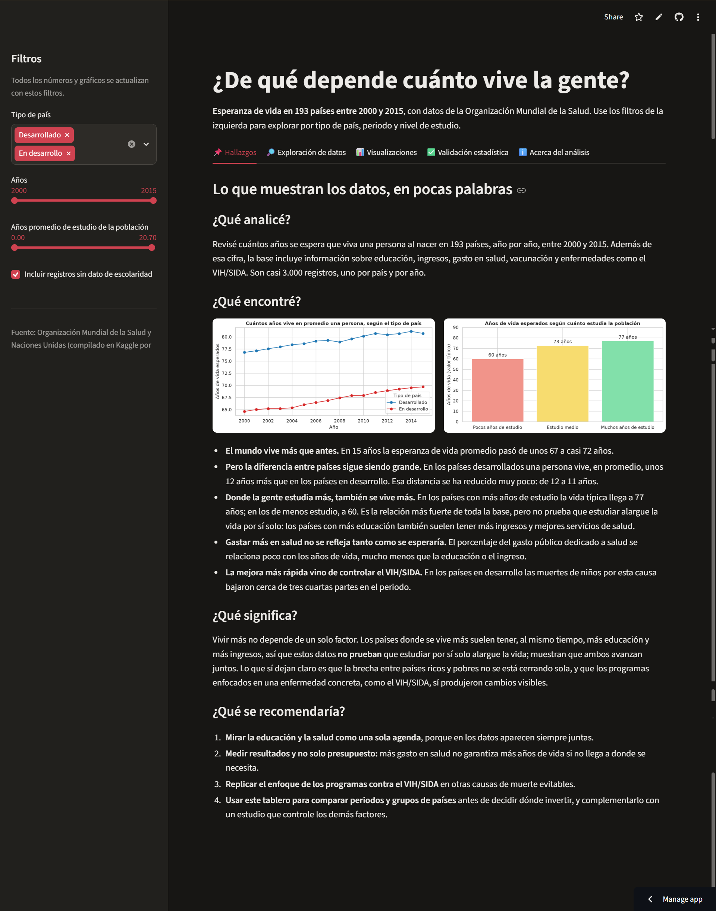

# ¿De qué depende cuánto vive la gente? Dashboard de esperanza de vida (OMS, 2000-2015)

[](URL_DEL_DASHBOARD)

**Dashboard publicado:** URL_DEL_DASHBOARD

## Descripción del proyecto

Este proyecto convierte el análisis exploratorio de datos (EDA) de la Tarea 3 del curso *Programación para el análisis de datos* en un dashboard interactivo para personas que no son especialistas en datos, como directivos o responsables de políticas públicas. No es un análisis nuevo: usa los mismos datos, gráficos y conclusiones, presentados de forma que se puedan explorar con filtros y leer sin conocimientos de estadística.

El dataset es *Life Expectancy (WHO)*, que reúne 2.938 registros de 193 países entre 2000 y 2015. Lo publicó el Observatorio Mundial de la Salud de la OMS, complementado con datos económicos de Naciones Unidas, y lo compiló K. Rajarshi en Kaggle. Incluye la esperanza de vida al nacer junto con variables de educación, ingreso, gasto en salud, vacunación y mortalidad.

Se eligió porque la esperanza de vida resume en un solo número las condiciones de salud, educación e ingreso de un país, y entender qué factores la acompañan ayuda a priorizar inversiones públicas, sobre todo en países en desarrollo como Colombia.

## Captura del dashboard



## Secciones del dashboard

- **Filtros (barra lateral):** tipo de país (desarrollado o en desarrollo), rango de años y rango de años promedio de estudio.
- **Hallazgos:** narrativa para audiencia no técnica: qué se analizó, qué se encontró, qué significa y qué se recomienda.
- **Exploración de datos:** métricas (registros, países, media, desviación estándar y mediana), tabla filtrable con buscador y descarga en CSV.
- **Visualizaciones:** cinco gráficos de la Tarea 3 (boxplot, dispersión, violín, tendencia temporal y gráfico combinado) que se actualizan con los filtros.
- **Validación estadística:** prueba t de Welch entre países desarrollados y en desarrollo, explicada en lenguaje claro.

## Hallazgos principales del EDA

1. La esperanza de vida promedio subió de 66,8 a 71,6 años entre 2000 y 2015.
2. En los países desarrollados se vive en promedio 12,1 años más que en los países en desarrollo, una diferencia significativa (prueba t de Welch, p < 0,001). La brecha solo se redujo de 12,2 a 11,0 años.
3. La escolaridad es la variable más asociada a la esperanza de vida (r = 0,75), seguida del índice de composición del ingreso (0,72). El gasto en salud como porcentaje del gasto público tiene una relación débil (0,22).
4. Las muertes infantiles por VIH/SIDA cayeron cerca de 74 % en los países en desarrollo, lo que coincide con buena parte del aumento de su esperanza de vida.
5. Las correlaciones no implican causalidad: educación, ingreso y salud avanzan juntas, y cada país aparece 16 veces (una por año).

## Instalación y ejecución local

1. Instalar Python 3.10 o superior.
2. Clonar el repositorio:
   ```bash
   git clone URL_DEL_REPOSITORIO
   cd NOMBRE_DEL_REPOSITORIO
   ```
3. (Opcional) Crear y activar un entorno virtual:
   ```bash
   python -m venv venv
   venv\Scripts\activate        # Windows
   source venv/bin/activate     # macOS / Linux
   ```
4. Instalar las dependencias:
   ```bash
   pip install -r requirements.txt
   ```
5. Ejecutar el dashboard:
   ```bash
   streamlit run app.py
   ```
6. Abrir http://localhost:8501 en el navegador.

## Estructura del repositorio

| Archivo | Contenido |
|---|---|
| `app.py` | Código del dashboard |
| `life_expectancy.csv` | Dataset original (Life Expectancy Data, OMS) |
| `requirements.txt` | Librerías necesarias |
| `README.md` | Este documento |
| `captura_dashboard.png` | Captura del dashboard publicado |

## Autor

**Iván Darío Ladino Gahona** – Grupo 35
Curso: Programación para el análisis de datos (203008069)
Tutor: Felipe Alexander Pipicano Guzmán
Universidad Nacional Abierta y a Distancia (UNAD) – Especialización en Ciencia de Datos y Analítica
Noviembre de 2026

**Fuente de los datos:** Rajarshi, K. (2018). *Life Expectancy (WHO)* [Conjunto de datos]. Kaggle. https://www.kaggle.com/datasets/kumarajarshi/life-expectancy-who
